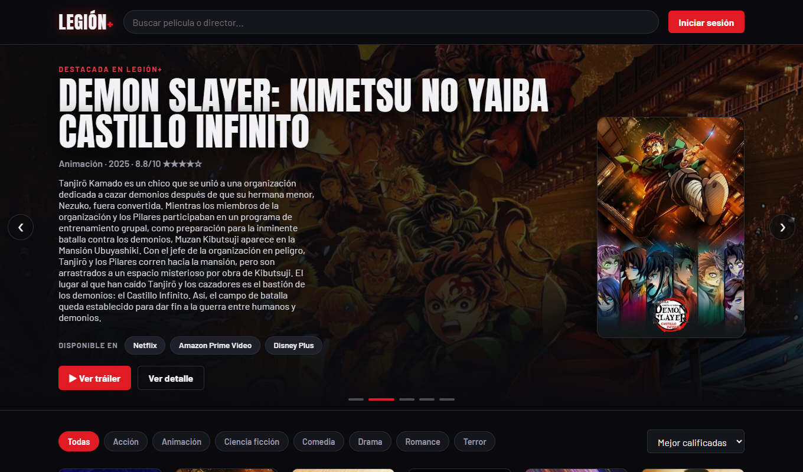
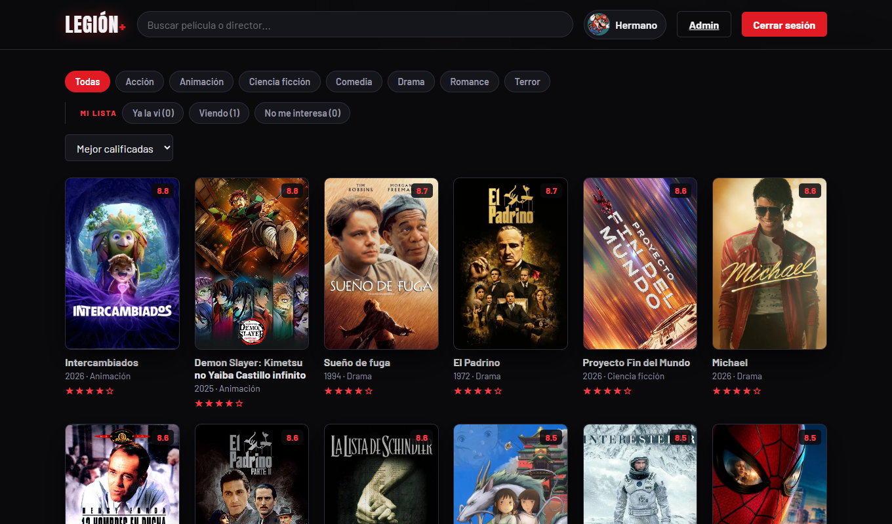
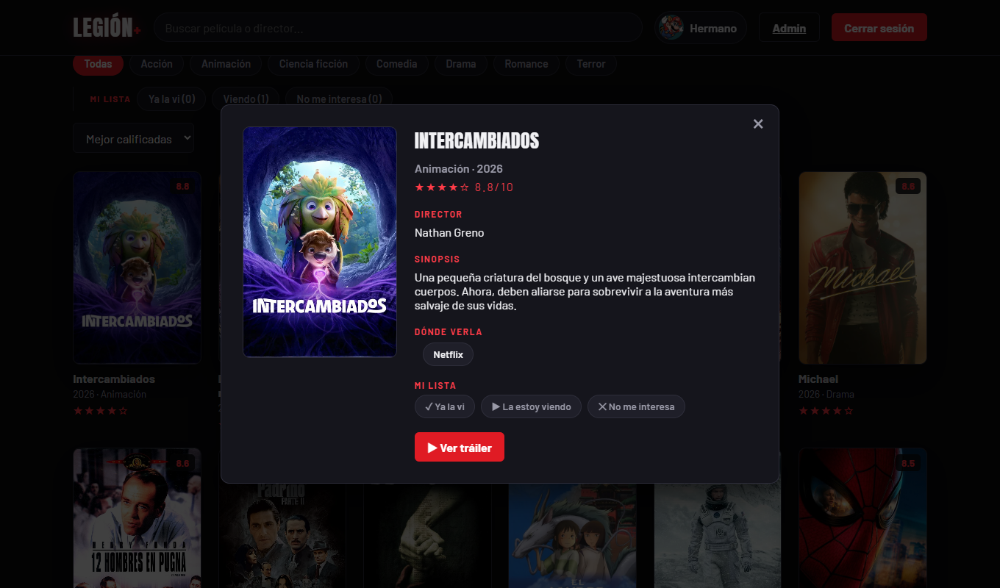
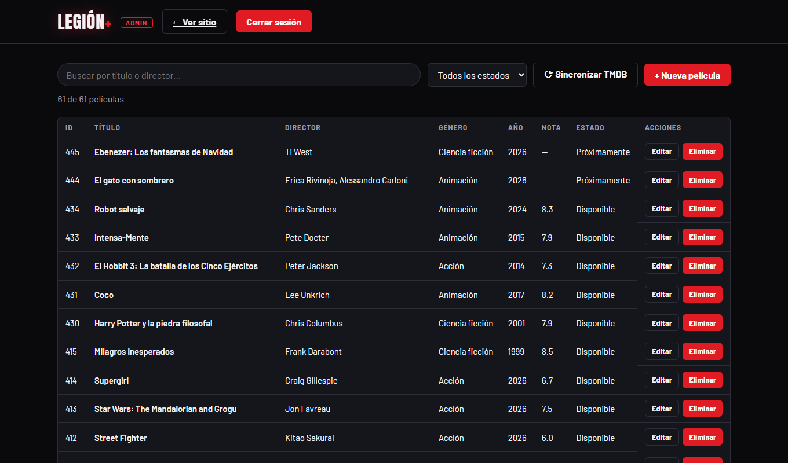

<h1 align="center">Legión+</h1>

<p align="center">
  API REST de películas construida con Flask y SQLite, con autenticación JWT,
  panel de administración e interfaz web propia.<br>
  El catálogo no está escrito a mano: se llena desde <b>The Movie Database</b>.
</p>

<p align="center">
  
  
  
  
  
</p>



## Qué es

Legión+ administra la cartelera de una plataforma de streaming. La API expone
las cinco operaciones del CRUD sobre la tabla `peliculas`, protege las de
escritura con un token JWT, valida todos los campos y responde los errores con
el código HTTP que corresponde.

Encima de la API hay dos páginas hechas con HTML, CSS y JavaScript puros, sin
frameworks:

- **La interfaz pública**, tipo Netflix: carrusel, buscador, filtros por género
  y, para quien tenga cuenta, perfiles con su propia lista de "ya la vi / la
  estoy viendo / no me interesa". Nunca modifica el catálogo.
- **El panel de administración**, al que solo entra la cuenta con rol `admin`.
  Desde ahí se crean, editan y eliminan películas y se sincroniza con TMDB.

### Lo que hace por dentro

| | |
| --- | --- |
| **Base de datos** | SQLite, cuatro tablas (`usuarios`, `peliculas`, `perfiles`, `vistas`) |
| **Autenticación** | JWT firmado con HS256, con caducidad y **rol** dentro del token |
| **Validaciones** | campos obligatorios, tipos, rangos y reglas propias del tema |
| **Errores** | 400, 401, 404, 405, 413, 429, 500 y 502, en JSON o como página |
| **API externa** | The Movie Database, más PokeAPI y Rick and Morty para los avatares |
| **Seguridad** | secretos fuera del código, hash scrypt, freno a la fuerza bruta, CSP |
| **Pruebas** | `python verificar.py` recorre la API entera: 57 comprobaciones |

### Cómo se ve

<table>
  <tr>
    <td width="50%"></td>
    <td width="50%"></td>
  </tr>
  <tr>
    <td align="center"><sub>Cartelera, filtros y "mi lista" por perfil</sub></td>
    <td align="center"><sub>Ficha con tráiler y dónde verla</sub></td>
  </tr>
  <tr>
    <td colspan="2"></td>
  </tr>
  <tr>
    <td colspan="2" align="center"><sub>Panel de administración: crear, editar, eliminar y sincronizar</sub></td>
  </tr>
</table>

## Primer arranque (cuatro pasos)

Requisito previo: **Python 3.10 o superior**.

```bash
pip install -r requirements.txt
copy .env.example .env
```

Abre `.env` y pon al menos `ADMIN_USER`, `ADMIN_PASSWORD` y `TMDB_API_KEY`
(ver [Configuración](#configuración)). Después:

```bash
python app.py
```

La base de datos `peliculas.db` **se crea sola** al arrancar, pero llega
**vacía**, porque el repositorio no incluye datos. Para llenarla con películas
reales basta una petición (ver [Llenar la cartelera](#llenar-la-cartelera)):

```bash
curl -X POST http://127.0.0.1:5000/sincronizar -H "Authorization: Bearer <token>" -H "Content-Type: application/json" -d "{}"
```

Ya está. Las direcciones son:

| | |
| --- | --- |
| API | <http://127.0.0.1:5000> |
| Interfaz web | <http://127.0.0.1:5000/static/index.html> |
| Panel de administración | <http://127.0.0.1:5000/static/admin.html> |

El `pip install` baja Flask y PyJWT, que son las dos únicas dependencias.

## Configuración

**En este repositorio no hay ninguna contraseña ni clave de API.** Los secretos
viven en un archivo `.env` que cada quien crea en su computador y que
`.gitignore` impide subir. `config.py` los lee al arrancar.

Primer paso después de clonar:

```bash
copy .env.example .env
```

Después se abre `.env` y se rellena:

| Variable | Para qué sirve | ¿Obligatoria? |
| -------- | -------------- | ------------- |
| `SECRET_KEY` | firma los tokens JWT | recomendada |
| `ADMIN_USER` | usuario del administrador | **sí** |
| `ADMIN_PASSWORD` | su contraseña | **sí** |
| `TMDB_API_KEY` | para llenar la cartelera | para sincronizar |
| `MINUTOS_EXPIRACION_TOKEN` | duración del token (60) | no |
| `MAX_INTENTOS` / `SEGUNDOS_BLOQUEO` | freno a la fuerza bruta (5 / 300) | no |
| `FLASK_DEBUG` | `1` solo para desarrollar | no |

Para generar una `SECRET_KEY` larga:

```bash
python -c "import secrets; print(secrets.token_hex(32))"
```

La clave de The Movie Database es gratuita: se saca en
<https://www.themoviedb.org> → Ajustes → API.

**El servidor no arranca si faltan `ADMIN_USER` y `ADMIN_PASSWORD`.** Es a
propósito: así nadie queda con unas credenciales por defecto sin darse cuenta.

De aquí en adelante, donde los ejemplos digan `TU_USUARIO` y `TU_CONTRASENA`
van los valores que pusiste en tu `.env`.

## Qué NO se sube al repositorio

`.gitignore` deja fuera dos cosas, y las dos a propósito:

- **`.env`** — tiene las contraseñas y la clave de la API.
- **`*.db`** — la base guarda los perfiles y sus claves (aunque estén
  hasheadas). Además se crea sola al arrancar, así que no hace falta subirla.

Por eso, al clonar el repositorio la cartelera arranca **vacía**. Para llenarla
está la sección [Llenar la cartelera](#llenar-la-cartelera): una sola petición
a `/sincronizar` la deja con decenas de películas reales.

Los perfiles pueden tener una clave propia de 4 dígitos. Nunca se devuelve en
las respuestas: la API solo informa `"tiene_clave": true`.

## Seguridad

- **Dos roles**: las operaciones de administración exigen rol `admin`, y la
  comprobación la hace el servidor en cada petición, no el navegador.
- **Ningún secreto está escrito en el código**: todos salen de `.env`, que
  no se sube al repositorio.
- La contraseña del administrador y las claves de perfil se guardan como
  **hash salado (scrypt)**, nunca en texto plano. Las claves guardadas con el
  esquema anterior (SHA-256) se siguen aceptando y se migran solas al entrar.
- Tras **5 intentos fallidos** (en el login o en la clave de un perfil) se
  bloquea ese origen **5 minutos** y la API responde `429`. Lo lleva
  `limitador.py`.
- El usuario y la contraseña se comparan en **tiempo constante**, para no
  filtrar información por lo que tarda la respuesta.
- Todas las respuestas llevan cabeceras de seguridad: `Content-Security-Policy`,
  `X-Content-Type-Options`, `X-Frame-Options` y `Referrer-Policy`.
- El cuerpo de una petición no puede pasar de **1 MB** (`413` si se pasa), y
  los campos de texto tienen un largo máximo.
- Todas las consultas SQL usan parámetros `?`, y SQLite arranca con
  `PRAGMA foreign_keys = ON`.
- El modo depuración está **apagado** salvo que se ponga `FLASK_DEBUG=1`.

## Panel de administración

<http://127.0.0.1:5000/static/admin.html>, o con el botón **Admin** que aparece
en la barra del sitio al iniciar sesión.

Pide usuario y contraseña de administrador y desde ahí se pueden **crear,
editar y eliminar películas** y lanzar la sincronización con TMDB, con buscador
y filtro por estado. La interfaz pública solo lee: no muestra esos botones.

## Cuentas y roles

Hay **dos tipos de cuenta**, y el rol viaja dentro del token JWT:

| Rol | De dónde sale | Qué puede hacer |
| --- | ------------- | --------------- |
| `admin` | del `.env` (`ADMIN_USER` / `ADMIN_PASSWORD`); se crea sola al arrancar | todo lo de un usuario, **más** crear, editar y eliminar películas y sincronizar con TMDB |
| `usuario` | se registra desde el sitio con **Crear cuenta** | ver la cartelera, crear sus perfiles y llevar su lista |

Nadie puede registrarse como administrador: `POST /registro` siempre crea
cuentas con rol `usuario`, aunque el cuerpo pida otra cosa.

**Qué ve cada quien:**

- **Sin cuenta** — la cartelera completa, el buscador, los filtros y los
  tráilers. No puede crear perfiles ni marcar nada.
- **Usuario** — además, sus propios perfiles y su lista de "ya la vi / la estoy
  viendo / no me interesa". **No ve el botón Admin**, y si entra al panel a mano
  se le rechaza.
- **Administrador** — todo lo anterior, más el panel de administración.

Cada cuenta ve **solo sus perfiles**: intentar leer o modificar el perfil de
otra cuenta devuelve `404`, como si no existiera.

## Obtener el token

Las rutas que escriben necesitan un token. Se pide una sola vez a `/login` y
dura 60 minutos.

En Postman:

| Campo  | Valor                                             |
| ------ | ------------------------------------------------- |
| Metodo | `POST`                                            |
| URL    | `http://127.0.0.1:5000/login`                     |
| Body   | raw, tipo JSON                                    |
| Cuerpo | `{"username": "TU_USUARIO", "password": "TU_CONTRASENA"}` |

Responde `{"token": "eyJhbGciOi..."}`. Ese valor es el que va despues en la
cabecera `Authorization: Bearer <token>` de las rutas protegidas.

El mismo paso en CMD:

```
curl -X POST http://127.0.0.1:5000/login -H "Content-Type: application/json" -d "{\"username\":\"TU_USUARIO\",\"password\":\"TU_CONTRASENA\"}"
```

> Los comandos `curl` de este README estan probados en **CMD** (Simbolo del
> sistema). En PowerShell `curl` es un alias de otra cosa y las comillas se
> interpretan distinto; alli usa Postman o `Invoke-RestMethod`.


## Base de datos

Cuatro tablas en SQLite, todas con `id` automático:

**`peliculas`** — `titulo`, `director` y `genero` (texto), `anio` (entero),
`calificacion` (decimal), y opcionales `sinopsis`, `poster_url`, `fondo_url`,
`trailer_url`, `plataformas`, `fecha_estreno` y `estado`
(`disponible` o `proximamente`).

**`usuarios`** — `username` (único), la contraseña con hash y el `rol`
(`admin` o `usuario`).

**`perfiles`** — pertenecen a una cuenta (`usuario_id`); `nombre`, `avatar` y
una `clave` opcional de 4 dígitos.

**`vistas`** — qué marcó cada perfil sobre cada película: `vista`, `viendo` o
`no_interesa`. No admite marcas repetidas del mismo perfil sobre la misma
película.

### Reglas de validación

- `titulo`, `director`, `genero` y `anio` son obligatorios; `calificacion`
  también, salvo en los estrenos que aún no salen.
- `anio` entre 1888 y el año actual (los estrenos próximos pueden ser futuros).
- `calificacion` entre 0 y 10.
- `genero` solo puede ser Acción, Animación, Ciencia ficción, Comedia, Drama,
  Romance o Terror.
- `estado` solo `disponible` o `proximamente`, y si es un estreno necesita
  `fecha_estreno`.
- `poster_url` y `fondo_url` deben empezar por `http://` o `https://`.
- `trailer_url` debe ser un enlace de YouTube.

## Rutas

| Método | Ruta                                  | Token | Qué hace                          |
| ------ | ------------------------------------- | ----- | --------------------------------- |
| GET    | `/`                                   | no    | Mensaje de bienvenida             |
| POST   | `/registro`                           | no    | Crea una cuenta de usuario (201)  |
| POST   | `/login`                              | no    | Devuelve el token JWT             |
| GET    | `/sesion`                             | sí    | Comprueba si el token sigue válido |
| GET    | `/peliculas`                          | no    | Lista todas las películas         |
| GET    | `/peliculas/<id>`                     | no    | Consulta una película             |
| POST   | `/peliculas`                          | admin | Crea una película (201)           |
| PUT    | `/peliculas/<id>`                     | admin | Actualiza todos sus campos        |
| DELETE | `/peliculas/<id>`                     | admin | Elimina una película              |
| POST   | `/sincronizar`                        | admin | Importa la cartelera desde TMDB   |
| GET    | `/avatares`                           | no    | Galería de avatares               |
| GET    | `/perfiles`                           | sí    | Lista **tus** perfiles            |
| POST   | `/perfiles`                           | sí    | Crea un perfil                    |
| PUT    | `/perfiles/<id>`                      | sí    | Edita nombre, avatar y clave      |
| DELETE | `/perfiles/<id>`                      | sí    | Elimina un perfil                 |
| POST   | `/perfiles/<id>/entrar`               | sí    | Comprueba la clave del perfil     |
| GET    | `/perfiles/<id>/vistas`               | sí    | Lo que marcó ese perfil           |
| PUT    | `/perfiles/<id>/vistas/<pelicula>`    | sí    | Marca vista, viendo o no_interesa |
| DELETE | `/perfiles/<id>/vistas/<pelicula>`    | sí    | Quita la marca                    |

Las rutas protegidas esperan la cabecera `Authorization: Bearer <token>`.

Las marcadas como **admin** además exigen que la cuenta tenga ese rol; si no, responden `403`.

## Probar las cinco operaciones

| # | Operacion     | Metodo y ruta          | Token | Cuerpo    |
| - | ------------- | ---------------------- | ----- | --------- |
| 1 | Listar todas  | `GET /peliculas`       | no    | -         |
| 2 | Consultar una | `GET /peliculas/<id>`  | no    | -         |
| 3 | Crear         | `POST /peliculas`      | si    | ver abajo |
| 4 | Actualizar    | `PUT /peliculas/<id>`  | si    | ver abajo |
| 5 | Eliminar      | `DELETE /peliculas/<id>` | si  | -         |

Cuerpo para crear y actualizar. `PUT` reemplaza la pelicula entera, asi que hay
que volver a mandar todos los campos:

```json
{
  "titulo": "Pelicula de prueba",
  "director": "Ana Lopez",
  "genero": "Drama",
  "anio": 2024,
  "calificacion": 8.5
}
```

Los mismos cinco pasos en CMD. Cambia `<token>` por el que devolvio `/login`
y `<id>` por uno de los que salgan en el primer comando (los ids no empiezan
en 1: los asigna la base de datos a medida que se importan las peliculas):

```
curl http://127.0.0.1:5000/peliculas

curl http://127.0.0.1:5000/peliculas/<id>

curl -X POST http://127.0.0.1:5000/peliculas -H "Authorization: Bearer <token>" -H "Content-Type: application/json" -d "{\"titulo\":\"Pelicula de prueba\",\"director\":\"Ana Lopez\",\"genero\":\"Drama\",\"anio\":2024,\"calificacion\":8.5}"

curl -X PUT http://127.0.0.1:5000/peliculas/<id> -H "Authorization: Bearer <token>" -H "Content-Type: application/json" -d "{\"titulo\":\"Pelicula de prueba\",\"director\":\"Ana Lopez\",\"genero\":\"Comedia\",\"anio\":2024,\"calificacion\":9.1}"

curl -X DELETE http://127.0.0.1:5000/peliculas/<id> -H "Authorization: Bearer <token>"
```

Codigos esperados, en orden: `200`, `200`, `201`, `200`, `200`.

Los ejemplos de `curl` van sin tildes porque la consola de Windows las manda mal.
En Postman si se pueden escribir con tildes sin problema.


## Llenar la cartelera

Con el servidor encendido y el token en la mano:

```
curl -X POST http://127.0.0.1:5000/sincronizar -H "Authorization: Bearer <token>" -H "Content-Type: application/json" -d "{}"
```

Trae las películas populares y mejor calificadas, los próximos estrenos y, si se
le pasa `{"buscar": ["Interstellar", "Dune Part Two"]}`, también esos títulos.
De cada una guarda título, director, género, año, calificación, sinopsis,
póster, imagen de fondo, tráiler de YouTube y en qué plataformas está en
Colombia. Repetir el comando actualiza lo que ya existe, no lo duplica.

## Verificación

Con el servidor encendido, en otra terminal:

```bash
python verificar.py
```

Recorre la API entera en nueve secciones: el login, las cinco operaciones,
que el token sea obligatorio, las validaciones, los errores 400/401/404/405
tanto en JSON como en forma de página, el registro de cuentas y los permisos de
cada rol, los perfiles con su clave y las marcas de "mi lista", y por último que
el catálogo esté completo.

Son **57 comprobaciones**. Imprime un resumen y termina con código de salida 0
si todas pasan, o 1 si falla alguna.

## Errores

Todos se devuelven en JSON con el formato `{"error": "mensaje"}`:

- `400` datos inválidos o cuerpo sin JSON
- `401` credenciales incorrectas, token ausente, inválido o expirado
- `403` la cuenta no tiene permiso (no es administrador)
- `404` película, perfil o ruta inexistente
- `409` ese nombre de usuario ya está registrado
- `405` método no permitido en esa ruta
- `413` la petición pasa de 1 MB
- `429` demasiados intentos fallidos; espera unos minutos
- `500` error interno del servidor
- `502` The Movie Database no responde

Si la petición llega desde un navegador, el error se muestra como página HTML
en lugar de JSON.

## Estructura

```
app.py            crea la app, cabeceras de seguridad y arranque del servidor
config.py         lee el .env: claves, administrador, límites y duración del token
.env              los secretos (no se sube a Git; .env.example es la plantilla)
database.py       conexión a SQLite y creación de las cuatro tablas
auth.py           registro, login y los candados token_requerido / solo_admin
limitador.py      freno a los intentos fallidos (fuerza bruta)
validaciones.py   reglas de validación de películas y perfiles
avatares.py       galería de avatares (archivos locales + PokeAPI + Rick and Morty)
repositorio.py    consultas SQL
peliculas.py      las cinco rutas de /peliculas y la sincronización
perfiles.py       perfiles, su clave y lo que cada uno marcó
tmdb.py           descarga las películas desde The Movie Database
errores.py        respuestas de error y manejadores HTTP
verificar.py      recorrido de prueba de toda la API
templates/        página de error en HTML
static/index.html interfaz pública (solo lectura)
static/admin.html panel de administración
static/           CSS, JavaScript e imágenes
```
